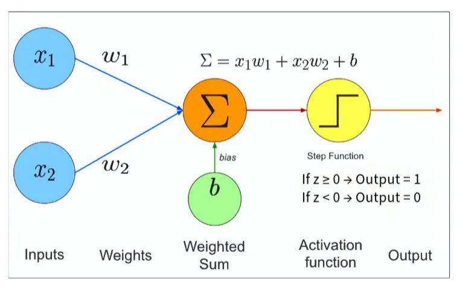

# AI Security — Study Notes
## 1. Artificial Intelligence (AI)

Artificial Intelligence is the field of building computer systems that perform tasks that normally require human intelligence.

Examples:
- Understanding language
- Recognizing images
- Solving problems
- Making predictions

### AI vs. Machine Learning vs. Deep Learning

- **AI:** The broader field of making machines perform intelligent tasks.
- **Machine Learning (ML):** A way to achieve AI by allowing models to learn patterns from data.
- **Deep Learning (DL):** A type of machine learning that uses neural networks with multiple layers.

## 2. AI Security vs. AI Safety

**AI Security:** Protecting AI systems against attacks and unauthorized access.

Examples:
- Data poisoning
- Model theft
- Adversarial attacks
- Prompt injection

**AI Safety:** Making AI systems behave safely and avoid harmful outcomes.

The distinction:
- Security focuses on protecting systems from attackers.
- Safety focuses on preventing harmful or unintended behavior.

## 3. AI System vs. ML Model

An **AI system** is the complete application and its surrounding infrastructure.

It can include:
- ML models
- APIs
- Databases
- User interfaces
- External tools
- Authentication systems

An **ML model** is the trained mathematical component that processes inputs and produces outputs.

Security testing must consider both the model and the surrounding system.

## 4. History of AI

The term Artificial Intelligence was introduced by **John McCarthy** in 1956 at the Dartmouth Conference.

Other important contributors:
- Marvin Minsky: Co-founder of the MIT AI Laboratory.
- Nathaniel Rochester: Worked on the IBM 701 and early AI research.
- Claude Shannon: Developed information theory, which influenced computing and AI.

## 5. The Perceptron

A perceptron is one of the simplest artificial neurons.

It receives inputs, multiplies them by weights, adds a bias, and produces a prediction.

The mathematical formula:

$$
z = (x_1w_1)+(x_2w_2)+b
$$

Where:
- $x$: Input features.
- $w$: Weights.
- $b$: Bias.
- $z$: Calculated score.

A step activation function can convert the score into a binary prediction:

- Positive score → 1 (Yes).
- Zero or negative score → 0 (No).

### Understanding weights

Weights determine how strongly each input influences the prediction.

- Positive weight: Increasing the input increases the score.
- Negative weight: Increasing the input decreases the score.
- Zero weight: The input has no influence on the score.

The model doesn't understand the meaning of these inputs like a human. It learns mathematical relationships from training data.

## 6. Training a Perceptron

The model learns by comparing its predictions with the correct labels in the training dataset.

Example:

| Movie | Runtime | Actual preference |
|---|---:|---|
| Movie A | 90 min | Liked (1) |
| Movie B | 100 min | Liked (1) |
| Movie C | 180 min | Disliked (0) |

The model makes predictions and compares them with the actual labels.

**Error formula:**

$$
Error = Target - Prediction
$$

Examples:

| Target | Prediction | Error |
|---:|---:|---:|
| 1 | 0 | +1 |
| 0 | 1 | -1 |
| 1 | 1 | 0 |
| 0 | 0 | 0 |

The target comes from the training dataset, not from the model.

## 7. Learning Rate

The learning rate controls how much the weights change during each update.

A simplified perceptron update:

$$
w_{new}=w_{old}+(\eta \times Error \times x)
$$

Where:
- $\eta$: Learning rate.
- Error: Difference between target and prediction.
- $x$: Input feature.

A very large learning rate can cause unstable updates. A very small one can make training slow.

## 8. Epochs

An epoch means one complete pass through the entire training dataset.

For example:

- Dataset: 100 movies.
- One epoch: The model processes all 100 movies once.
- 50 epochs: The model processes the dataset 50 times.

During training, weights can be updated repeatedly.

Important terms:

- Dataset: Collection of training examples.
- Iteration: One training step or update.
- Epoch: One complete pass through the dataset.

## 9. Final Weights and Training Results

In the book's example:

| Parameter | Initial value | Final value |
|---|---:|---:|
| W1 | 0.5 | 43.6 |
| W2 | 0.8 | -2.2 |
| Bias | -60 | 3.2 |

W2 represents movie runtime.

Its final value is negative, meaning longer runtime decreases the prediction score.

The model learned this relationship from the training examples and their labels. The author did not manually tell it to dislike long movies.

**Important:** 100% training accuracy means the model correctly classified all examples in that training dataset. It doesn't guarantee correct predictions on new movies.

## 10. How Training Is Automated

Humans don't manually adjust every weight.

Developers write training code that automates the process:

1. Feed training data into the model.
2. Generate predictions.
3. Calculate the loss (prediction error).
4. Use backpropagation to calculate gradients.
5. Use an optimizer to update weights.
6. Repeat the process.

The goal is to minimize the overall training loss while also achieving good performance on unseen data.

## 11. Connection to AI Security / Red Teaming

The concepts above are directly relevant to AI security.

### Data Poisoning
An attacker manipulates training data or labels to influence what the model learns.

Connection: Training datasets and labels.

### Evasion Attacks
An attacker crafts inputs that cause a trained model to make incorrect predictions.

Connection: Input features and predictions.

### Model Extraction
An attacker queries a model and uses its outputs to build a substitute model.

Connection: Model access and API outputs.

### Model Manipulation
An attacker attempts to modify model parameters or the model itself.

Connection: Weights, biases, and model files.

---

## 12. Important Concepts to Learn Next

To understand modern AI systems and attack them effectively, continue with:

1. Artificial Neurons
2. Neural Networks
3. Activation Functions
4. Loss Functions
5. Gradient Descent
6. Backpropagation
7. Training vs. Inference

**Main takeaway:** AI models learn mathematical patterns from data by adjusting their parameters. Understanding this process helps us understand how attackers can manipulate training data, inputs, model behavior, and AI infrastructure.
